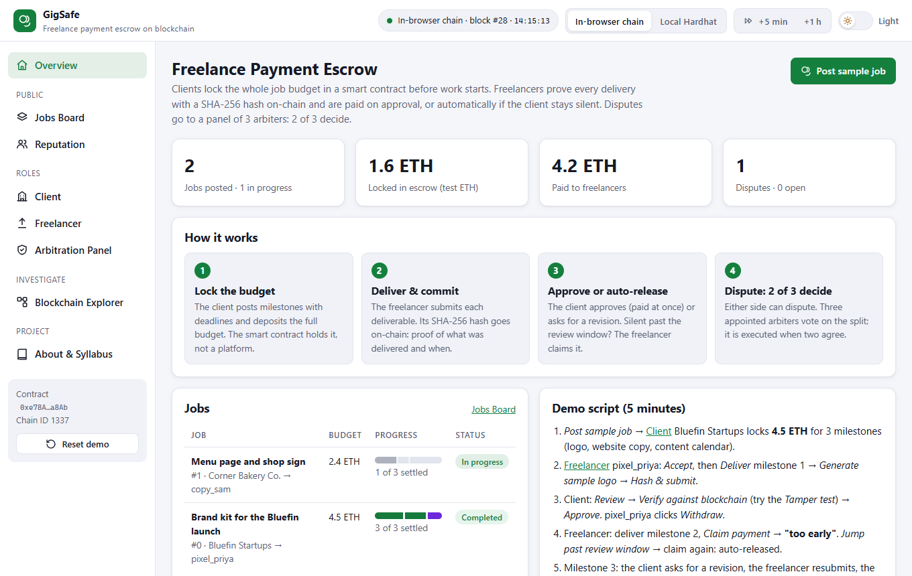
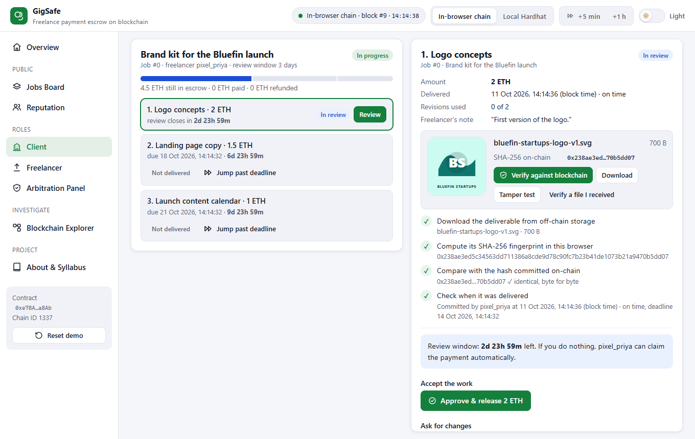
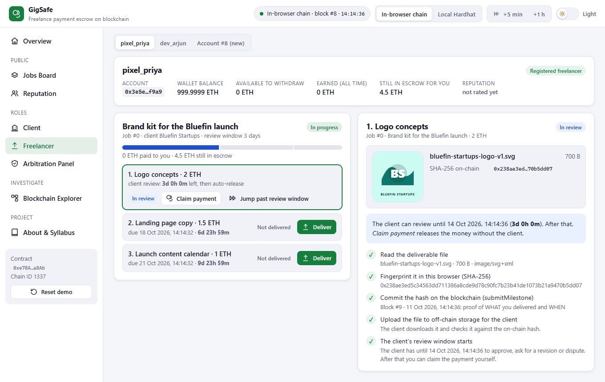
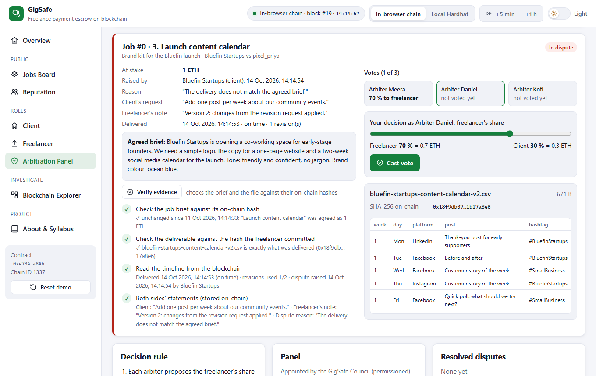
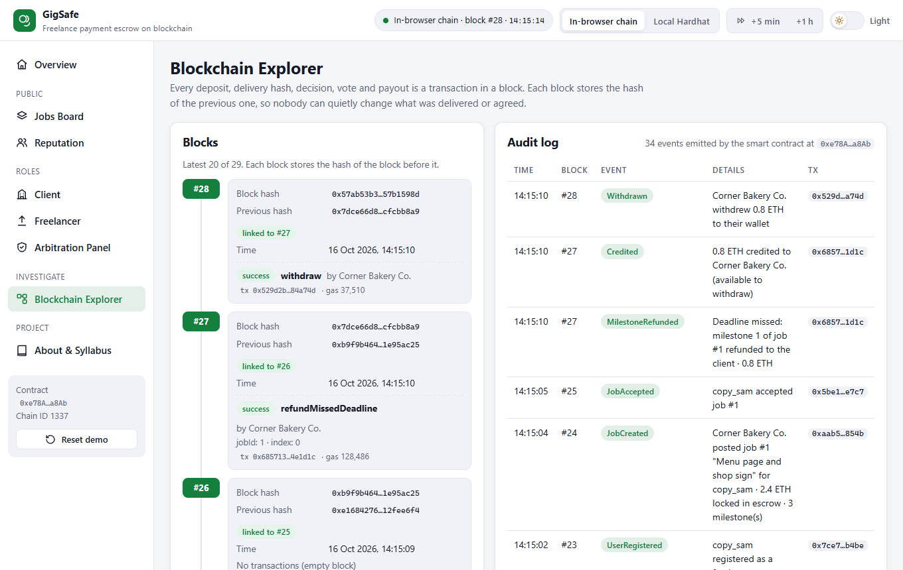
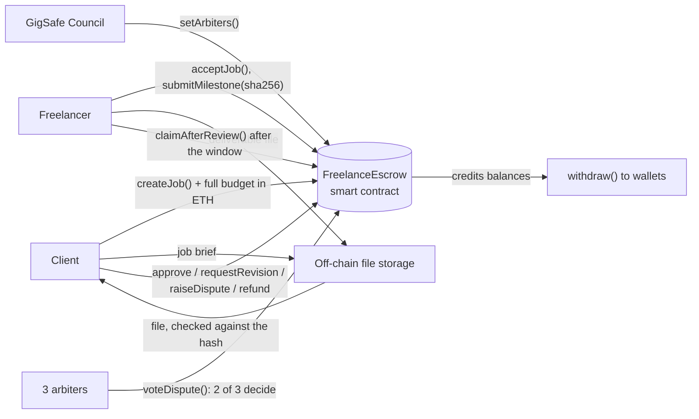

# GigSafe: Smart Contract-Based Freelance Payment Escrow

A blockchain escrow for freelance work: the client **locks the whole job budget in a smart contract**, the freelancer **proves each delivery with a SHA-256 hash on-chain**, payments are released on approval or **automatically when the client stays silent**, and disputes are settled by **3 arbiters, 2 of whom must agree**.

**Live demo:** https://syedareeb06.github.io/freelance-payment-escrow/ (runs entirely in your browser: no wallet, no install, test ETH only)



---

## The problem

Clients and freelancers who have never met do not trust each other:

- freelancers fear doing the work and not getting paid,
- clients fear paying up front and not getting the work, and
- platforms that hold the money in between charge high fees and decide disputes behind closed doors.

## The solution

| Step | What happens | Technique |
|---|---|---|
| 1. Lock the budget | The client posts a job split into milestones with deadlines and **deposits the full budget into the smart contract**. The job brief stays off-chain; its SHA-256 hash is committed so the agreed scope cannot be changed later. | `payable` escrow, SHA-256 commitment |
| 2. Deliver & commit | The freelancer submits each deliverable. The file is hashed in the browser and **only its SHA-256 goes on-chain**: proof of exactly which file was delivered, and when (block time). | Hash commitment + timestamp |
| 3. Approve or auto-release | The client downloads the file, checks it against the on-chain hash and **approves (paid at once)** or asks for a revision (max 2). If the client does nothing within the **review window**, the freelancer **claims the payment automatically**. A missed deadline refunds the client. | Time-based rules (`block.timestamp`) |
| 4. Dispute: 2 of 3 decide | Either side can raise a dispute. A **panel of 3 arbiters** appointed by the GigSafe Council votes on the freelancer's share; the split is **executed as soon as two votes agree** (if all three differ, the median is executed). Both sides then rate each other on-chain. | Majority agreement, permissioned panel |

All payouts are **pull payments**: the contract credits a balance and each person withdraws it, which keeps the escrow safe from re-entrancy and from recipients that reject ETH.

## Features

- **Client**: post a job with milestones (amount, deliverable type, deadline) and lock the escrow with live steps; review each delivery: download, **verify against the blockchain**, *Tamper test* (one flipped bit → hash mismatch), verify a file received elsewhere; approve, request a revision or raise a dispute; refund missed deadlines; cancel before acceptance; withdraw; rate the freelancer
- **Freelancer**: self-register (permissionless), accept offers (the escrow is visible before you start), deliver with **built-in sample deliverables generated in the browser** (SVG logo, website copy, CSV content calendar) or your own file (up to 5 MB), claim payment after the review window, dispute a revision request, withdraw, rate the client
- **Arbitration Panel**: open disputes with both sides' evidence, *Verify evidence* (brief and file checked against their hashes), vote on the split with a slider, see every arbiter's vote, resolved disputes with the rule used
- **Jobs Board**: every job with a milestone progress bar and the money still in escrow
- **Reputation**: freelancer and client leaderboards by average rating, completed jobs and volume
- **Blockchain Explorer**: hash-linked blocks, decoded transactions and the audit log in plain sentences
- **Time travel**: *+5 min* / *+1 h* in the top bar, plus *Jump past review window* and *Jump past deadline* buttons on the pages
- **Light / dark theme switch** in the top bar; responsive down to phone width
- Two blockchains: an **in-browser Ethereum chain** (zero setup) or a **local Hardhat node**

| Client verifies a delivery against the chain | Freelancer delivers a milestone |
|---|---|
|  |  |

| Arbiters vote on a dispute (2 of 3) | Blockchain explorer |
|---|---|
|  |  |

## Syllabus mapping (22CS743, Blockchain Technology)

| Module | Concepts | Where they appear in this project |
|---|---|---|
| **II** | Hash functions and commitments, timestamping, consensus by majority / Byzantine agreement, hash-linked blocks | SHA-256 of every deliverable and of the job brief committed with the block time; one changed bit is detected (*Tamper test*). Arbiters reach agreement by a 2-of-3 majority; the median rule keeps the result between the honest votes when one arbiter is biased. The explorer checks each block's previous-hash link. |
| **III** | Ethereum, smart contracts, `payable`, time-based logic, signed transactions | `FreelanceEscrow.sol`: `createJob` is `payable` and must receive exactly the budget; `block.timestamp` enforces review windows (auto-release) and deadlines (refunds); every action is a transaction signed by the party's own account |
| **IV** | Permissioned / consortium governance | A small permissioned panel: only the GigSafe Council appoints the 3 arbiters, and the panel cannot change while a dispute is open. Clients and freelancers join without permission. |
| **V** | Smart-contract security, real-world applications | Pull payments (credit + `withdraw()`), checks-effects-interactions, re-entrancy lock (tested with an attack contract), role checks, custom errors, accounting invariant. Application: the gig economy, trust and reputation without a middleman. |

## Architecture



**On-chain:** users and roles, the arbiter panel, job title, budget, milestone amounts and deadlines, brief hash, deliverable hashes, notes and revision requests, timestamps, disputes and every vote, ratings, credited balances.
**Off-chain:** the job brief text and the deliverable files. Anyone holding them can check them against the on-chain hashes.

### Smart contract at a glance

| Function | Who | What it does |
|---|---|---|
| `setArbiters(address[3], string[3])` | Council | Appoint the panel (not while a dispute is open) |
| `registerUser(role, name)` | anyone, once | Join as client or freelancer |
| `createJob(freelancer, title, descriptionHash, amounts[], deadlines[], reviewWindow)` payable | client | Lock exactly the budget; 1-10 milestones |
| `cancelJob(jobId)` | client | Full refund before the freelancer accepts |
| `acceptJob(jobId)` | freelancer | Start the job |
| `submitMilestone(jobId, i, deliverableHash, note)` | freelancer | Commit the delivery (a revision must change the hash) |
| `approveMilestone(jobId, i)` | client | Credit the freelancer |
| `requestRevision(jobId, i, reason)` | client | Within the review window, max 2; extends the deadline |
| `claimAfterReview(jobId, i)` | freelancer | Auto-release after the review window (`TooEarly` before) |
| `refundMissedDeadline(jobId, i)` | client | Refund when nothing (new) was delivered by the deadline |
| `raiseDispute(jobId, i, reason)` | client or freelancer | Freeze the milestone for the panel |
| `voteDispute(jobId, i, freelancerShareBps)` | arbiter, once | 2 equal votes execute the split; 3 different votes execute the median |
| `rate(jobId, stars)` | client and freelancer, once each | 1-5 stars after completion |
| `withdraw()` | anyone with a balance | Pull payment (re-entrancy locked) |

## Tech stack

- **Smart contract:** Solidity 0.8.24, Hardhat (local blockchain, 29 tests, deployment)
- **Frontend:** HTML, CSS, JavaScript (no build step), ethers.js v6, Web Crypto API (SHA-256)
- **Demo blockchain:** Ganache running inside the browser (same EVM, same contract)
- **Hosting:** GitHub Pages

## Project structure

```
freelance-payment-escrow/
├── blockchain/                              # Smart contract project (Hardhat)
│   ├── contracts/FreelanceEscrow.sol
│   ├── contracts/test/ReentrantFreelancer.sol   # attack contract used only by the tests
│   ├── test/FreelanceEscrow.test.js         # 29 unit tests
│   ├── scripts/deploy.js                    # deploy + set up the demo community on localhost
│   ├── scripts/export-artifact.js           # copy ABI + bytecode into the web app
│   └── hardhat.config.js
├── frontend/                                # Web app (open index.html)
│   ├── index.html
│   ├── css/
│   ├── js/app.js                            # GigSafe screens and logic
│   ├── js/gigsafe-crypto.js                 # job brief, sample deliverables (SVG/TXT/CSV), previews
│   ├── js/chain.js                          # in-browser chain / local Hardhat connection
│   ├── js/contract-artifact.js              # compiled contract (generated)
│   └── vendor/                              # ethers.js, Ganache (browser builds)
├── docs/screenshots/
└── index.html                               # redirects GitHub Pages to frontend/
```

## How to run

### Option 1: Zero install (recommended for demos)

Open the [live demo](https://syedareeb06.github.io/freelance-payment-escrow/), **or** double-click `frontend/index.html`.
An Ethereum blockchain starts inside the page with 10 test accounts (1000 test ETH each). Your data is saved in the browser; click **Reset demo** in the sidebar to start over.

### Option 2: Local Hardhat blockchain

Requires [Node.js](https://nodejs.org/) 18 or newer.

```bash
cd blockchain
npm install
npm run node
```

Keep that terminal open. In a second terminal:

```bash
cd blockchain
npm run deploy
```

Then open `frontend/index.html` and click **Local Hardhat** in the top bar. (If you skip `npm run deploy`, the app deploys the contract itself.)

### Run the smart contract tests

```bash
cd blockchain
npm test
```

### After changing the contract

```bash
cd blockchain
npm run export
```

This recompiles and copies the new ABI and bytecode into `frontend/js/contract-artifact.js`.

## Demo accounts

| Account | Role | Name |
|---|---|---|
| 0 | Admin (appoints the arbiter panel) | GigSafe Council |
| 1, 2, 3 | Arbiter panel | Arbiter Meera, Arbiter Daniel, Arbiter Kofi |
| 4, 5 | Clients (self-registered) | Bluefin Startups, Corner Bakery Co. |
| 6, 7 | Freelancers (self-registered) | pixel_priya, dev_arjun |
| 8 | Freelancer, registers during the demo | copy_sam |

All names are fictional demo personas.

## 5-minute demo script

1. **Overview** → *Post sample job* → *Lock budget & post job*. Bluefin Startups locks **4.5 ETH** for 3 milestones (logo 2 ETH, website copy 1.5 ETH, content calendar 1 ETH). Watch the 4 steps.
2. **Freelancer** (pixel_priya) → *Accept job* → *Deliver* milestone 1 → *Generate sample logo* → *Hash & submit on-chain*. Only the SHA-256 goes on-chain.
3. **Client** → *Review* → *Tamper test* (one flipped bit: **hash mismatch**) → *Verify against blockchain* (4 checks pass) → *Approve & release 2 ETH*. Back in **Freelancer**, *Withdraw* moves it to the wallet.
4. **Freelancer** → deliver milestone 2 → *Claim payment*. The smart contract blocks it: **"too early"**, the client still has 3 days. *Jump past review window* → *Claim payment*: **auto-released**.
5. Deliver milestone 3 → **Client** *Request revision* → **Freelancer** *Deliver v2* (a new hash) → **Client** *Raise dispute*.
6. **Arbitration Panel** → Arbiter Meera: *Verify evidence*, slider at **70 %**, *Cast vote*. Arbiter Daniel: the same → **2 of 3 agree**: 0.7 ETH to the freelancer, 0.3 ETH back to the client.
7. Both sides rate each other → **Reputation**, **Jobs Board**, **Blockchain Explorer**.

Optional: register `copy_sam` (account 8), post the Corner Bakery sample job to him, accept it, then as the client *Jump past deadline* → *Refund (deadline missed)*.

## Publishing on GitHub Pages

1. Push this folder to a GitHub repository named `freelance-payment-escrow`.
2. On GitHub: **Settings → Pages → Build and deployment → Source: Deploy from a branch → Branch: `main`, folder: `/ (root)` → Save**.
3. After about a minute the site is live at `https://syedareeb06.github.io/freelance-payment-escrow/`.

## Limitations and future work

- A hash proves which file was delivered and when, not that the work is good. Quality disputes still need human arbiters.
- The arbiters are trusted to be independent. A real platform would rotate them, pay them a fee and ask them to stake a deposit that can be slashed.
- Ratings can be gamed if one person controls both a client and a freelancer account; real platforms add identity checks or weight ratings by volume.
- Job titles, amounts, notes and revision requests are public on-chain; only the brief and the files are kept off-chain.
- The demo keeps files in browser storage (files over 256 KB are hashed but not stored). A real system would use IPFS or encrypted cloud storage, and a stablecoin instead of ETH to avoid price swings. A production deployment could run on a permissioned network such as Hyperledger Besu.

## License

MIT, see [LICENSE](LICENSE).
